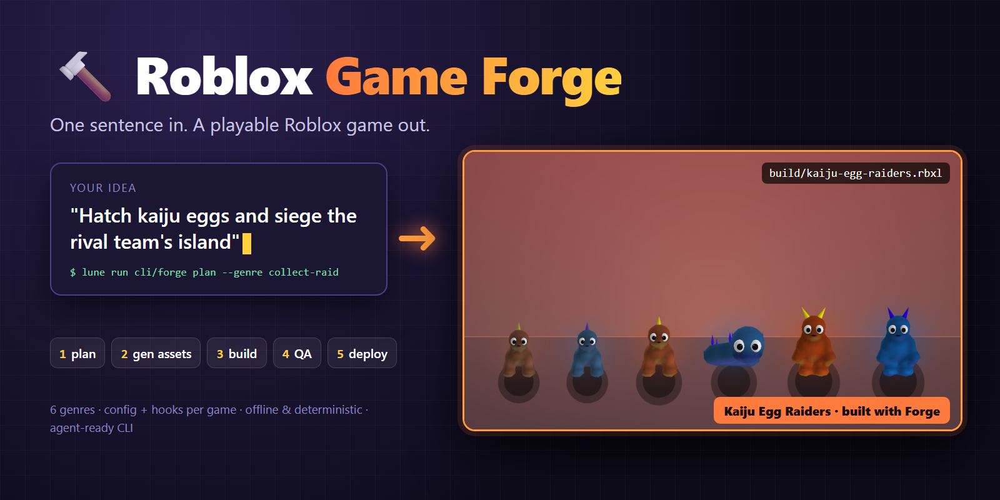
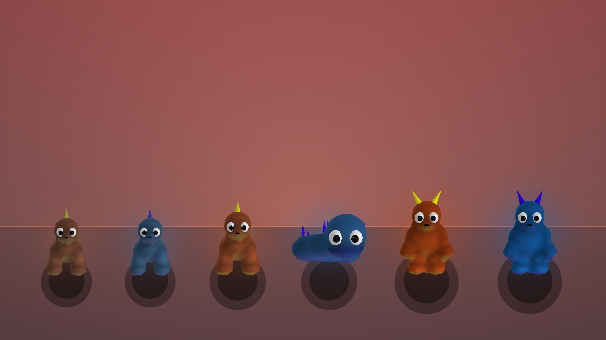

<div align="center">



**Describe a game in one sentence, then get a Roblox place you can build, test and ship.**

A Lune-based meta-framework that takes a Roblox game from idea through
planning, assets, build, automated QA and staged deploy. It is built so that
AI agents (and humans) can produce new games over and over.


</div>

---

## ✨ What is this?

Most Roblox games in the same genre run on the same skeleton: currencies, a save
system, shops, game passes, waves, raids, harvest loops, analytics. Forge writes
that skeleton **once** and lets each new game be mostly **configuration plus a
few hooks**.

```text
"Defend ancient groves from clockwork beasts"
                │
                ▼
   forge plan ──► game.yml + econ.yml + starter Luau     (deterministic, no LLM)
                │
   forge gen  ──► procedural models, icons, launch art, audio
                │
   forge build ─► build/<pack>.rbxl                        (Rojo + place inspection)
                │
   forge qa   ──► headless scenarios derived from the genre spec
                │
   forge deploy ► staging experience (production needs human approval)
```

- **One sentence in, a playable place out.** `forge plan` derives the title, teams, economy balance and starter code from a genre template with a fixed seed, so the same input always gives the same output.
- **Genres are reusable packages.** A game pack never copies or edits framework code. It only sets config and registers hooks such as `OnHarvest` or `OnWaveSpawn`.
- **Built for agents.** Every step is a CLI command with defined exit codes, works offline where it can, and leaves evidence that a reviewer can check.
- **Fair monetization by design.** Robux buys only deterministic items. Random rolls (egg hatching and the like) run only on free currency.

## 🧱 How it is layered

```text
┌──────────────────────────────────────────────────────────────┐
│  games/        Game Packs: one folder per game               │
│                game.yml · econ.yml · assets · locale · hooks  │
├──────────────────────────────────────────────────────────────┤
│  genres/       Genre Modules: reusable loop rules,            │
│                QA scenarios, economy templates                │
├──────────────────────────────────────────────────────────────┤
│  core/domain   Engine-free pure Luau (runs under Lune):      │
│                economy · progression · inventory · crafting   │
│  core/infra    Roblox adapters: DataStore · net · monetization│
│                analytics · localization · liveops · audio     │
└──────────────────────────────────────────────────────────────┘
          ▲ cli/forge: the Lune CLI that drives all of it
```

`core` and every genre are semver packages. Each game pins the versions it uses
in its own `forge-lock.yml`, so changing a game never breaks another one.

## 🎮 Built-in genres

| Genre | Core loop |
| --- | --- |
| `collect-raid` | Collect and hatch creatures, then raid the other team's base as a team |
| `grow-harvest` | Plant, grow, harvest, sell, expand |
| `survival-coop` | Gather and craft together, then survive waves |
| `rpg-progression` | Quests, levels, gear progression |
| `social-rp-fashion` | Dress-up, roleplay, social spaces |
| `pvp-arena` | Rounds, matchmaking, ranked combat |

Want another one? See [Adding a new genre](genres/README.md) and the [genre spec](docs/forge/genre-spec.md).

### Sample packs in `games/`

<p align="center">
  
</p>
<p align="center"><sub>Kaiju Egg Raiders: the kaiju are modeled procedurally by Forge, with no hand-made meshes</sub></p>

| Pack | Genre | Notes |
| --- | --- | --- |
| `kaiju-egg-raiders` | collect-raid | First pack: hatch kaiju eggs, siege the rival team's island |
| `grow-and-defend-garden` | grow-harvest + survival-coop | Cozy garden by day, defend it by night |
| `plan-demo` | collect-raid | Output of `forge plan` for "sky whale egg keepers" |

## 📊 Status

Honest current state, as of this release:

- **Structure works end to end.** `forge sweep` generates, builds, and inspects a
  game for every genre variant — 7 variants (6 genres plus the survival-coop
  crafting variant) — and reports **7/7 fully passed** on the structural columns:
  generate, files, build, inspect, spec, HUD, world, surface, load, quality.
- **Load and quality columns exist.** `sweep` runs a headless 8-actor load proof
  (join, concurrent action, save, leave, rejoin, checked for duplicate grants,
  conservation, and persistence) and writes a quality evidence receipt for the
  pack's declared tier. The receipt never mints human approval.
- **Fun and visual quality are unverified.** The receipt records them as
  human-judgment-pending in every case. No claim is made here that any generated
  game is fun, or looks good.
- **Audio is DECLARED, not playable.** Generation writes real 44.1 kHz cue files
  and the pack declares them, but the sweep's audio column reads `DECLARED`
  because the published Roblox asset ids are absent until the WAVs are uploaded
  with Roblox asset-upload scope. Until then the generated games are silent.
- **Art is prototype-grade.** Creature, prop, icon, and launch-art assets are
  first-party procedural output, not production art.
- **Studio interaction is Windows-first.** Interactive Studio runs, multi-client
  QA, and capture tooling target Windows with Roblox Studio installed. Offline
  commands (generate, build, inspect, spec, econ, plan) are platform-neutral.

## 🚀 Quick start

You need [Rokit](https://github.com/rojo-rbx/rokit). It installs the rest of the pinned toolchain.

```powershell
# 1. Install the pinned tools (Rojo, Lune, Selene, StyLua, luau-lsp, Wally)
rokit install

# 2. Check the whole repo: lint, format, types, specs, then build every pack
lune run cli/forge check

# 3. Plan a brand-new game from a single sentence
lune run cli/forge plan --concept "Defend ancient groves from clockwork beasts" `
  --genre survival-coop --pack grove-defense --seed 42

# 4. Build it into a place file -> build/grove-defense.rbxl
lune run cli/forge build --pack grove-defense
```

Open the `.rbxl` in Roblox Studio, or live-sync with `rojo serve`.

> [!NOTE]
> The first `check` downloads the Roblox type definitions into `build/cache/`.
> After that it runs fully offline and needs no keys.

## 🧰 Command cheat sheet

| Stage | Command | What it does |
| --- | --- | --- |
| Idea | `trends [--fixture <path>]` | Summarize top Roblox experiences by genre and flag genres not covered yet |
| Plan | `new <slug> --genre <g>` | Scaffold an empty game pack |
| | `plan --concept "..." --genre <g> --pack <slug>` | Generate a complete starter pack from one sentence |
| Economy | `econ sim --pack <slug> --players 20 --days 7` | Simulate the in-game economy offline |
| Assets | `gen procedural` · `gen icons` · `gen launchart` · `gen audio` | Generate assets locally, no keys needed |
| | `assets check` · `assets codegen` | Validate the asset manifest and generate the Luau asset table |
| Content | `content check` · `locale check` · `locale sync` | Validate content and translations |
| Build | `build [--pack <slug> \| --all]` | Rojo build plus inspection of the built place |
| | `sweep` | Generate, build and inspect every genre variant in one run |
| QA | `qa plan` · `qa run --native` · `smoke --local` | Run scenario QA headless and smoke-test the place |
| Quality | `quality check --pack <slug> --target starter` | Check the pack's quality tier |
| Ship | `deploy plan` · `deploy --dry-run` · `deploy --env staging` | Plan and publish through Open Cloud |
| Operate | `liveops` · `report` | Send live events and produce reports |

Run any command as `lune run cli/forge <command>`. Use `lune run cli/forge --help`
for the overview, and see the [CLI contract](docs/release/cli-contract.md) for
every flag and exit code.

## 🔑 Offline first, keys only for live actions

Planning, generation, building, simulation and QA all run **without credentials**.
Keys come from environment variables and only matter when you touch live Roblox
services:

| Variable | Used for |
| --- | --- |
| `ROBLOX_STAGING_API_KEY`, `ROBLOX_STAGING_UNIVERSE_ID`, `ROBLOX_STAGING_PLACE_ID` | `deploy --env staging`, `liveops` |
| `ROBLOX_PRODUCTION_API_KEY` + matching IDs + `FORGE_ALLOW_PRODUCTION=1` | Production deploy (also requires human approval) |
| `ROBLOX_API_KEY` | `assets status` (moderation check), `smoke --cloud` |
| `IMAGE_GEN_URL` · `TRELLIS_URL` · `ELEVENLABS_API_KEY` | Optional external generators for `gen image` · `gen mesh` · `gen sfx` |

Keys never fall back to one another, and a staging key that matches the
production key is refused.

## 🛡️ Quality tiers and release gates

Forge never treats "it builds" as "it's ready to ship":

1. **`starter`**: every freshly generated or sample pack starts here. It builds and plays locally.
2. **`vertical-slice`** and **`release-candidate`**: these tiers require a local evaluator's attestation tied to source digests, build artifacts, captures, audio and QA scenario results.
3. **Production**: only a declared `release-candidate` with current approved evidence can be published. An agent can deploy to staging on its own; production always needs a human.

The details are in [Release authorization](docs/release/authorization.md),
[Operations](docs/release/operations.md) and [Rollback](docs/release/rollback.md).

## 💻 Platform support

| Platform | Status |
| --- | --- |
| Windows 10/11 x64 | Main target for local authoring, builds and Studio integration |
| Linux / macOS (headless) | Expected to work under Lune and Rojo, but not verified yet |
| Roblox Studio | Needed for interactive play testing and Studio MCP |

The toolchain versions are pinned in [`rokit.toml`](rokit.toml). Full details
are in the [Support guide](docs/release/support.md).

## 📚 Documentation

- [Installation](docs/release/install.md): installing from a source archive
- [CLI contract](docs/release/cli-contract.md): every command, flag, schema and exit code
- [Authoring](docs/release/authoring.md): how packs, hooks and generated files fit together
- [Studio QA](docs/release/studio-qa.md): Studio-based play and capture checks
- [Support and operations](docs/release/support.md): troubleshooting and recovery
- [AGENTS.md](AGENTS.md): rules for AI agents working in this repo

## 📄 License

[Sustainable Use License v1.0](LICENSE.md) with a **Commercial Game Runtime
Exception**: you may publish and monetize Roblox games built with Forge.
Forge itself, as a tool, may be used only for internal business, personal or
non-commercial purposes, and redistributed only free of charge.
This is source-available, not OSI open source. See also
[RUNTIME-LICENSE.md](RUNTIME-LICENSE.md) and [THIRD_PARTY_NOTICES.md](THIRD_PARTY_NOTICES.md).

> [!IMPORTANT]
> Forge is in a provisional pre-release state. See [CHANGELOG.md](CHANGELOG.md)
> for what has been verified so far and what is still pending.
